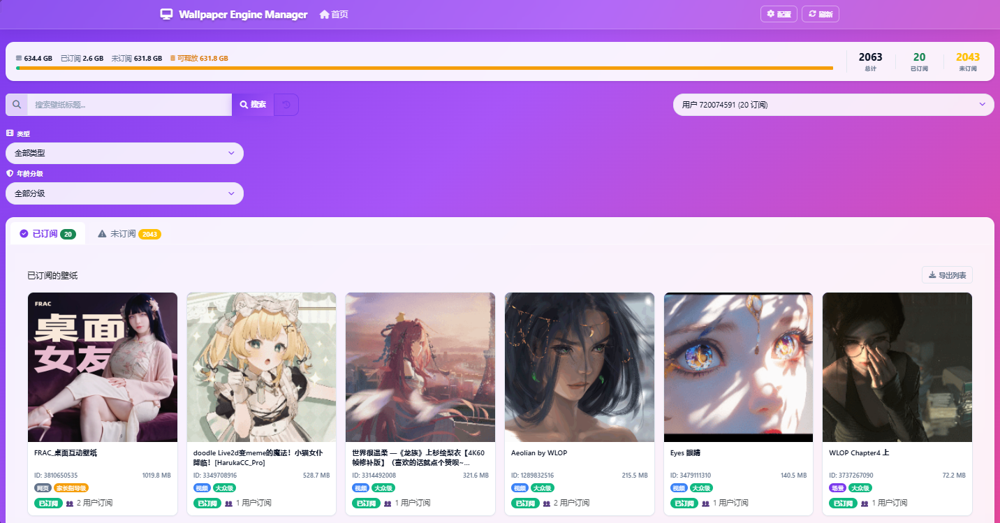

# Wallpaper Engine Web Manager

基于 Flask 的本地壁纸管理工具，通过浏览器浏览、搜索、清理 Steam Wallpaper Engine（App ID `431960`）的创意工坊内容。壁纸标题、类型、年龄分级、大小和订阅状态都从本机文件解析，不联网，也不调用 Steam Web API。



---

## 版本说明

| 版本 | 适用场景 | 说明 |
|------|----------|------|
| **Release** | 普通用户 | 打包为独立可执行文件，解压即用，无需安装 Python。下载地址见 [Releases](https://github.com/liu-yunhu/Wallpaper_Manager/releases) |
| **本地开发版**（当前仓库） | 开发者 / 进阶用户 | 需要 Python 环境，通过源码运行，适合二次开发与调试 |

---

## 功能特性

- **订阅对照** — 把创意工坊内容目录里的壁纸分成「已订阅」和「未订阅」两栏，默认按文件夹大小从大到小排列
- **多用户** — 读取本机每个 Steam 用户的订阅文件，可切换到单个用户查看
- **筛选** — 标题搜索，以及类型（场景 / 视频 / 网页 / 未知）、年龄分级（大众级 / 家长指导级 / 成人级(R-18) / 未分级）
- **预览图** — 优先使用壁纸目录里的 `preview.jpg` / `preview.png` / `preview.gif` 等标准文件名，找不到时再在目录内按扩展名挑一张不超过 50MB 的图片
- **详情** — 查看类型、年龄分级、路径（可复制）、各用户的订阅时间与是否本地禁用；可打开所在文件夹
- **清理** — 删除本地壁纸文件夹。未订阅栏可勾选后删除，或删除当前页已列出的项
- **导出** — 把已订阅或未订阅列表导出为 UTF-8 CSV（含 ID、标题、类型、年龄分级、大小、状态、路径）
- **存储统计** — 数量、占用空间，以及已订阅 / 未订阅的占比条。未订阅占用即页面上的「可释放」
- **网页配置** — 修改内容目录、Steam `userdata` 路径、端口和调试开关
- **路径检测** — `userdata` 留空时，依次尝试 Windows 注册表和常见安装路径；配置路径不存在时页面会提示实际使用的回退路径
- **搜索历史** — 保留最近 20 条关键词，可一键清空

界面使用 Bootstrap 5 和 Font Awesome，桌面与较窄窗口都能用。

---

## 订阅是怎么判定的

每个壁纸是内容目录下的一个纯数字文件夹：

`<Steam>/steamapps/workshop/content/431960/<workshop_id>/`

| 来源 | 作用 |
|------|------|
| `userdata/<用户ID>/ugc/431960_subscriptions.vdf` | 判断谁订阅了、是否在 Steam 里本地禁用。`disabled_locally` 为启用时才算已订阅 |
| 上面的文件读不到时，`workshop/appworkshop_431960.acf` 的已安装列表 | 只用于单个壁纸的详情。列表和统计不会用这份文件 |

查看「所有用户」时，已订阅是各用户**活跃订阅的并集**，并且内容目录里要有对应文件夹。某个用户单独查看时，已订阅只含该用户的活跃项；其余在磁盘上的壁纸（包括其他用户仍在订阅的）都会出现在「未订阅」里。

读不到任何用户的订阅文件时，列表会把磁盘上的壁纸全部归到未订阅。

删除只移除本地文件夹，不会在 Steam 里退订。切换到单个用户后，未订阅栏里可能仍有其他用户正在使用的壁纸，删除前需要自行确认。

---

## 技术栈

- **后端**：Flask（应用工厂）、[vdf](https://github.com/ValvePython/vdf)（解析订阅文件和 ACF）
- **前端**：Bootstrap 5、Font Awesome、原生 JavaScript（Fetch，无构建步骤）
- **打包**：PyInstaller 单文件 exe，入口是 `launcher.py`

`requirements.txt` 里还列了 Pillow。当前预览逻辑只查找图片文件，不再做缩放或抽帧，代码没有引用 Pillow。

---

## 快速开始

### 环境要求

- Python 3.8 及以上（开发时在 3.11、3.13、3.14 上运行过）
- 本机已安装 Steam，且 Wallpaper Engine 的创意工坊内容在本地

### 1. 克隆并安装依赖

```bash
git clone https://github.com/liu-yunhu/Wallpaper_Manager.git
cd Wallpaper_Manager
pip install -r requirements.txt
```

### 2. 配置路径

开发环境下配置文件是项目根目录的 `config.json`。首次启动前至少写好内容目录：

```json
{
  "steam_library_path": "F:\\SteamLibrary\\steamapps\\workshop\\content\\431960",
  "steam_userdata_path": "E:\\Software\\Steam\\userdata",
  "server": {
    "host": "127.0.0.1",
    "port": 5000,
    "debug": true
  }
}
```

- `steam_library_path`：指向 `.../workshop/content/431960` 这一层，不是 `workshop` 根目录
- `steam_userdata_path`：Steam 的 `userdata` 目录，可省略。留空或路径不存在时自动检测
- `server`：监听地址、端口、是否开启 Flask 调试重载。网页里保存配置时，主机会被写成 `127.0.0.1`

也可以先按默认配置启动，再用页面右上角的「配置」修改。内容目录和 `userdata` 保存后会立刻用于下一次查询；端口和调试开关要重启进程才生效。

打包后的 exe 不把配置写在 exe 旁边。首次运行会把内置的 `config.json` 复制到 `%APPDATA%\WallpaperManager\config.json`，搜索历史也写在这个目录。写入前会把当前配置备份为 `config.json.bak`。

### 3. 启动

开发：

```bash
python app.py
```

浏览器打开 `http://127.0.0.1:5000`。是否开启调试重载由 `config.json` 的 `server.debug` 决定，默认开启。

给普通使用或打包后的程序用启动器。它关闭调试重载，约 2 秒后自动打开浏览器：

```bash
python launcher.py
```

### 4. 打包

```bash
build.bat
```

等价于 `python -m PyInstaller launcher.spec`。产物是 `dist/WallpaperManager.exe`。

---

## 页面上的操作范围

- 已订阅、未订阅各自翻页。每页条数可以是 10、20、50，默认 20，也可以直接跳到某一页
- 「删除选中」删除未订阅栏里勾过的项，勾选会跨页保留
- 「删除全部」只删除未订阅栏**当前页**已经加载出来的壁纸，不会一次删掉所有未订阅项
- 「导出列表」会按当前的标题搜索和用户筛选，向接口请求全部匹配项（`page_size=0`）。类型和年龄分级筛选只影响页面上的列表，不会带进这次导出

---

## 项目结构

```
Wallpaper_Manager/
├── app.py                    # Flask 应用工厂与路由
├── launcher.py               # 启动器（关闭重载，自动打开浏览器；打包入口）
├── launcher.spec             # PyInstaller 配置
├── build.bat                 # 打包脚本
├── config.json               # 开发环境配置；打包后改用 %APPDATA%\WallpaperManager
├── requirements.txt
├── static/
│   ├── css/                  # Bootstrap、Font Awesome、style.css
│   ├── js/
│   │   └── app.js            # 列表、筛选、分页、删除、导出
│   ├── webfonts/
│   └── img/demo.png
├── templates/
│   ├── base.html             # 导航、配置弹窗
│   └── index.html            # 主页
├── api/
│   ├── wallpaper.py          # 列表、筛选、缓存、删除、统计
│   └── config.py             # 配置读写（白名单 + 备份）
└── utils/
    ├── steam_parser.py       # 订阅 VDF、ACF、Steam 路径
    ├── image_processor.py    # 预览图查找
    └── paths.py              # 开发目录 / 打包后的数据目录
```

运行后还会生成 `search_history.json`（开发时在项目根目录，打包后在数据目录）。

---

## API

响应一般为 `{ "success": true, "data": ... }`。失败时为 `{ "success": false, "error": "..." }`，并带对应 HTTP 状态码。

| 端点 | 方法 | 说明 |
|------|------|------|
| `/` | GET | 主页 |
| `/api/wallpapers` | GET | 分页列表。查询参数见下表 |
| `/api/wallpapers/<id>` | GET | 单个壁纸详情，额外包含 `subscribed` 与 `confidence` |
| `/api/wallpapers/<id>/preview` | GET | 预览图文件。没有预览图时尝试 `static/images/no-preview.png`，该文件不存在则 404 |
| `/api/wallpapers/<id>` | DELETE | 删除该壁纸的本地文件夹 |
| `/api/wallpapers/<id>/open-folder` | POST | 在系统文件管理器中打开文件夹（Windows 用 `explorer`） |
| `/api/stats` | GET | 存储统计。可选 `user`（Steam 用户 ID；省略或 `all` 表示全部用户） |
| `/api/users` | GET | Steam 用户列表。每项含 `id`、`display_name`（`用户 <id>`）、`subscription_count` |
| `/api/config` | GET / POST | 读取或更新配置。只会持久化白名单字段 |
| `/api/steam-paths` | GET | 配置中的 `userdata` 路径、实际使用的路径、内容目录，以及是否发生了回退 |
| `/api/search-history` | GET / POST / DELETE | 读取、写入一条关键词、或清空历史。POST 正文为 `{ "keyword": "..." }` |

`GET /api/wallpapers` 的查询参数：

| 参数 | 取值 |
|------|------|
| `user` | 省略或 `all`：所有用户的并集。否则为某个 Steam 用户 ID |
| `search` | 标题子串，不区分大小写 |
| `content_rating` | `Everyone`、`Questionable`、`Mature`、`none`（字段缺失）。空表示不筛选 |
| `wallpaper_type` | `scene`、`video`、`web`、`none`。空表示不筛选 |
| `subscribed_page` / `unsubscribed_page` | 各自的页码，从 1 开始。也接受旧参数 `page`，两栏共用 |
| `page_size` | `10`、`20`、`50`。`0` 表示该筛选条件下的全部结果（导出用）。其他值会退回 `20` |

列表数据分成 `data.subscribed` 与 `data.unsubscribed`。每一栏包含 `total`、`page`、`page_size`、`total_pages`、`wallpapers`。

单条壁纸的主要字段：`id`、`title`、`type`、`type_label`、`content_rating`、`content_rating_label`、`size`、`size_formatted`、`path`、`preview_available`、`preview_type`（`image` 或 `gif`）、`subscribed`、`subscription_details`、`subscribed_by_users`、`total_users`。标题缺失时为 `ID: <文件夹名>`。类型与分级的中文标签缺省为「未知」「未分级」。

`POST /api/config` 只会写入这些键：`steam_library_path`、`steam_userdata_path`、`workshop_file`、`content_path`、`server`、`preview`。保存成功后会清掉订阅数据缓存。`workshop_file` 和 `content_path` 可在配置文件里覆盖自动推算的 ACF 路径和内容目录，网页配置弹窗不会编辑这两项。
